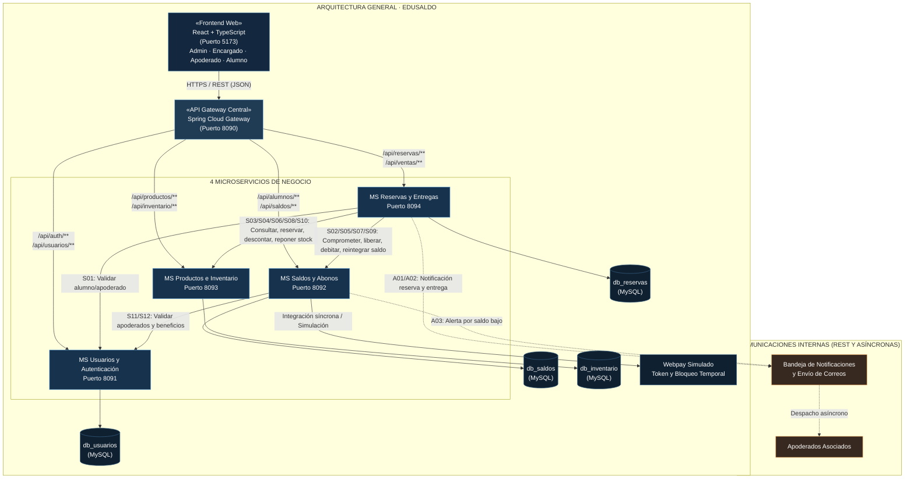
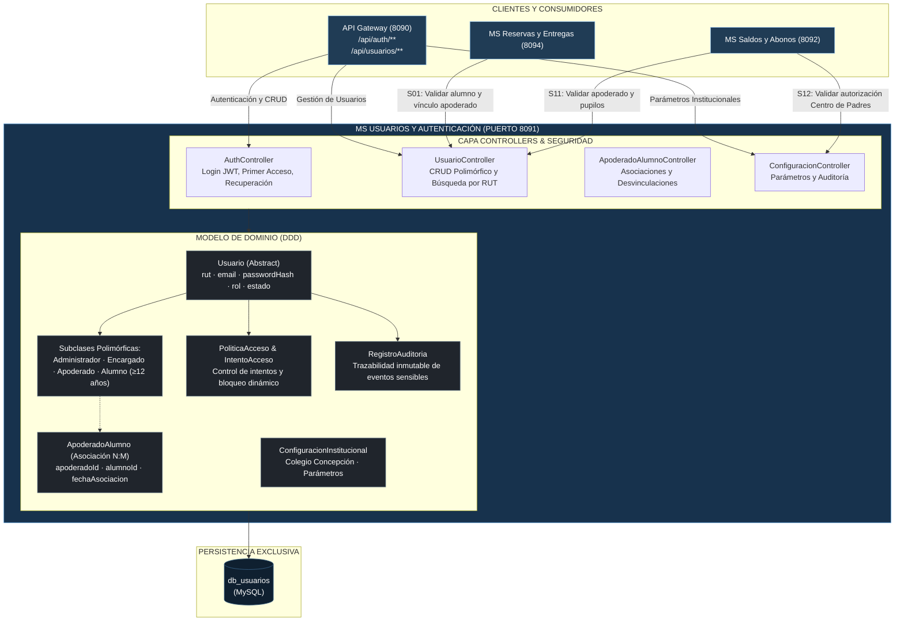

# Documentación del Sistema · EduSaldo

Repositorio centralizado de documentación técnica, funcional y arquitectónica de la plataforma **EduSaldo**, diseñado bajo el estándar **Docs-as-Code** con diagramas nativos en **Mermaid**.

---

## 📁 Archivos Formales del Repositorio

- 📊 **[`EduSaldo - Plantilla Gestión Requerimientos.xlsx`](EduSaldo%20-%20Plantilla%20Gestión%20Requerimientos.xlsx):** Planilla oficial y actualizada de requerimientos e Historias de Usuario (HU01 a HU56).
- 🏛️ **[`EduSaldo - Arquitectura de Sistema.docx`](EduSaldo%20-%20Arquitectura%20de%20Sistema.docx):** Documento formal e institucional de arquitectura en formato Word para entregas académicas.
- 🖼️ **[`diagramas/`](diagramas/):** Única fuente de verdad (*Single Source of Truth*) para los archivos fuente Mermaid:
  - [`mermaid-arquitectura-general.md`](diagramas/mermaid-arquitectura-general.md)
  - [`mermaid-ms-usuarios-8091.md`](diagramas/mermaid-ms-usuarios-8091.md)
  - [`mermaid-ms-saldos-abonos-8092.md`](diagramas/mermaid-ms-saldos-abonos-8092.md)
  - [`mermaid-ms-productos-inventario-8093.md`](diagramas/mermaid-ms-productos-inventario-8093.md)
  - [`mermaid-ms-reservas-entregas-8094.md`](diagramas/mermaid-ms-reservas-entregas-8094.md)

---

## 🚀 Clonación de la Suite Completa

Para clonar la solución completa con el API Gateway, los 4 microservicios backend, el Frontend SPA y este repositorio de documentación en un mismo directorio contenedor:

```bash
mkdir EduSaldo
cd EduSaldo

# 1. API Gateway Central (Orquestador de Rutas y Scripts)
git clone https://github.com/antoniojarasanchez/edusaldo-api-gateway.git

# 2. Los 4 Microservicios Backend
git clone https://github.com/antoniojarasanchez/edusaldo-ms-auth-usuarios.git
git clone https://github.com/antoniojarasanchez/edusaldo-ms-alumnos-saldos.git
git clone https://github.com/antoniojarasanchez/edusaldo-ms-productos-inventario.git
git clone https://github.com/antoniojarasanchez/edusaldo-ms-ventas-reservas.git

# 3. Frontend Web SPA (React + TypeScript)
git clone https://github.com/Flosotoo/paginaWeb.git

# 4. Repositorio de Documentación Centralizada
git clone https://github.com/antoniojarasanchez/edusaldo-docs.git
```

---

## 1. Arquitectura General del Sistema (Vista Global)

Modela la topología en estrella (*Hub & Spoke*) con el **API Gateway (8090)** como punto único de entrada, los 4 microservicios de negocio, sus 4 bases de datos MySQL aisladas y la integración con la pasarela Webpay simulada:



---

## 2. Diagramas Individuales por Microservicio

### 2.1. MS Usuarios y Autenticación (Puerto 8091 · `db_usuarios`)
Responsable de login JWT, usuarios polimórficos (`Administrador`, `Encargado`, `Apoderado`, `Alumno`), asociación `ApoderadoAlumno`, políticas de acceso, parámetros y auditoría institucional.



---

### 2.2. MS Alumnos y Saldos (Puerto 8092 · `db_saldos`)
Responsable de la cuenta corriente de saldo prepagado, la invariante financiera $\text{saldoDisponible} = \text{saldoActual} - \text{saldoComprometido} \ge 0$, el libro mayor inmutable de `MovimientoSaldo` y los abonos Webpay con bloqueo temporal.

```mermaid
flowchart TB
    subgraph EXT["CLIENTES Y EXTERNOS"]
      GW["API Gateway (8090)<br/>/api/alumnos/**<br/>/api/saldos/**"]
      MR["MS Reservas y Entregas (8094)"]
      WP["Pasarela Webpay (Simulada)<br/>Token y Bloqueo Temporal"]
      MU["MS Usuarios y Auth (8091)"]
      MAIL["Bandeja de Notificaciones<br/>y Correos"]
    end

    subgraph MS_SALDOS["MS SALDOS Y ABONOS (PUERTO 8092)"]
      direction TB

      subgraph API["CAPA CONTROLLERS & SERVICES"]
        SALDO_CTRL["SaldoController<br/>Consulta, Retención, Débito y Devolución"]
        ABONO_CTRL["AbonoController<br/>Abonos Webpay con Bloqueo de Concurrencia"]
        ALUMNO_CTRL["AlumnoController<br/>Cuentas de Alumnos y Liquidación por Retiro"]
      end

      subgraph DOMAIN["MODELO DE DOMINIO Y FINANCIERO"]
        direction TB
        CUENTA["CuentaSaldo<br/>alumnoId (Long) · saldoActual (int CLP)<br/>saldoComprometido (int CLP)"]
        INVARIANTE["Invariante Financiera:<br/>saldoDisponible = saldoActual - saldoComprometido ≥ 0"]
        MOVIMIENTO["MovimientoSaldo (Libro Mayor Inmutable)<br/>tipo: ABONO, RESERVA, DEBITO, REINTEGRO, LIQUIDACION<br/>monto (int CLP) · fechaHora · motivo · referenciaId"]
        ABONO["Abono<br/>tokenTransaccion · estado: PENDIENTE, CONFIRMADO, FALLIDO"]

        CUENTA --> INVARIANTE
        CUENTA *-- MOVIMIENTO
        ABONO ..> CUENTA : "acredita en"
      end

      API --> DOMAIN
    end

    subgraph PERSISTENCE["PERSISTENCIA EXCLUSIVA"]
      DB[("db_saldos<br/>(MySQL)")]
    end

    DOMAIN --> DB

    GW -->|"Consultas de Saldo y Carga"| SALDO_CTRL
    GW -->|"Abonar Saldo"| ABONO_CTRL
    MR -->|"S02: Comprometer saldo"| SALDO_CTRL
    MR -->|"S05: Liberar saldo comprometido"| SALDO_CTRL
    MR -->|"S07: Confirmar débito por entrega"| SALDO_CTRL
    MR -->|"S09: Reintegrar saldo por devolución"| SALDO_CTRL

    ABONO_CTRL <-->|"Integración síncrona"| WP
    ALUMNO_CTRL -->|"S11: Validar apoderado/alumnos"| MU
    ALUMNO_CTRL -->|"S12: Validar autorización subsidios"| MU
    SALDO_CTRL -.->|"A03: Alerta saldo bajo cruzoUmbral()"| MAIL

    classDef ms fill:#17324d,stroke:#65a6df,color:#ffffff
    classDef domain fill:#20252c,stroke:#65798a,color:#ffffff
    classDef client fill:#203c55,stroke:#8cbce8,color:#ffffff
    classDef db fill:#0f2030,stroke:#3b658b,color:#ffffff
    classDef event fill:#37291f,stroke:#e59a50,color:#ffffff

    class MS_SALDOS ms
    class CUENTA,INVARIANTE,MOVIMIENTO,ABONO domain
    class GW,MR,MU client
    class DB,WP db
    class MAIL event
```

---

### 2.3. MS Productos e Inventario (Puerto 8093 · `db_inventario`)
Responsable único del catálogo de artículos escolares, invariante de stock $\text{stockDisponible} = \text{stockFisico} - \text{stockReservado} \ge 0$, ingreso manual de mercadería y solicitudes de ajuste de stock solicitadas por Encargado y aprobadas por Administrador.

```mermaid
flowchart TB
    subgraph EXT["CLIENTES Y CONSUMIDORES"]
      GW["API Gateway (8090)<br/>/api/productos/**<br/>/api/inventario/**"]
      MR["MS Reservas y Entregas (8094)"]
    end

    subgraph MS_INVENTARIO["MS PRODUCTOS E INVENTARIO (PUERTO 8093)"]
      direction TB

      subgraph API["CAPA CONTROLLERS & SERVICES"]
        PROD_CTRL["ProductoController<br/>CRUD Catálogo y Consulta de Stock"]
        AJUSTE_CTRL["AjusteStockController<br/>Solicitudes de Ajuste y Aprobación"]
        INGRESO_CTRL["IngresoStockController<br/>Recepciones Físicas en Bodega"]
      end

      subgraph DOMAIN["MODELO DE DOMINIO E INVENTARIO"]
        direction TB
        PRODUCTO["Producto<br/>sku · nombre · precio (int CLP) · stockCritico<br/>stockFisico (int) · stockReservado (int)"]
        INVARIANTE["Invariante de Inventario:<br/>stockDisponible = stockFisico - stockReservado ≥ 0"]
        CATEGORIA["Categoria<br/>nombre · descripcion"]
        MOVIMIENTO["MovimientoInventario<br/>tipo: INGRESO, RESERVA, LIBERACION, ENTREGA, DEVOLUCION, AJUSTE<br/>cantidad (int) · fechaHora · motivo · referenciaId"]
        AJUSTE["SolicitudAjusteStock<br/>solicitanteId: Encargado<br/>administradorId: Administrador<br/>estado: PENDIENTE, APROBADA, RECHAZADA"]
        INGRESO["IngresoStock & DetalleIngresoStock<br/>guía/factura · proveedor · encargadoId"]

        PRODUCTO --> INVARIANTE
        PRODUCTO --> CATEGORIA
        PRODUCTO *-- MOVIMIENTO
        PRODUCTO -- AJUSTE
        INGRESO *-- PRODUCTO
      end

      API --> DOMAIN
    end

    subgraph PERSISTENCE["PERSISTENCIA EXCLUSIVA"]
      DB[("db_inventario<br/>(MySQL)")]
    end

    DOMAIN --> DB

    GW -->|"Gestión de Catálogo y Bodega"| PROD_CTRL
    GW -->|"Solicitar/Aprobar Ajustes"| AJUSTE_CTRL
    GW -->|"Registrar Ingresos Manuales"| INGRESO_CTRL

    MR -->|"S03: Consultar productos, precio y stock"| PROD_CTRL
    MR -->|"S04: Comprometer existencias (stockReservado++)"| PROD_CTRL
    MR -->|"S06: Liberar stock reservado (stockReservado--)"| PROD_CTRL
    MR -->|"S08: Confirmar salida física (stockFisico--)"| PROD_CTRL
    MR -->|"S10: Reingresar productos devueltos (stockFisico++)"| PROD_CTRL

    classDef ms fill:#17324d,stroke:#65a6df,color:#ffffff
    classDef domain fill:#20252c,stroke:#65798a,color:#ffffff
    classDef client fill:#203c55,stroke:#8cbce8,color:#ffffff
    classDef db fill:#0f2030,stroke:#3b658b,color:#ffffff

    class MS_INVENTARIO ms
    class PRODUCTO,INVARIANTE,CATEGORIA,MOVIMIENTO,AJUSTE,INGRESO domain
    class GW,MR client
    class DB db
```

---

### 2.4. MS Reservas y Entregas (Puerto 8094 · `db_reservas`)
Responsable del ciclo de vida de las reservas (carritos multilínea), trazabilidad de preparación (`preparadaPorId` y `fechaPreparacion` según HU31 CA2), despacho de entregas de materiales por concepto (sin facturación ni caja comercial física) y devoluciones.

```mermaid
flowchart TB
    subgraph EXT["CLIENTES Y DESTINOS"]
      GW["API Gateway (8090)<br/>/api/reservas/**<br/>/api/ventas/**"]
      MU["MS Usuarios y Auth (8091)"]
      MS["MS Saldos y Abonos (8092)"]
      MI["MS Productos e Inventario (8093)"]
      MAIL["Bandeja de Notificaciones<br/>y Correos"]
    end

    subgraph MS_RESERVAS["MS RESERVAS Y ENTREGAS (PUERTO 8094)"]
      direction TB

      subgraph API["CAPA CONTROLLERS & SERVICES"]
        RES_CTRL["ReservaController<br/>Creación, Preparación y Cancelación"]
        ENT_CTRL["EntregaController<br/>Despacho en Mesón sin Caja Comercial"]
        DEV_CTRL["DevolucionController<br/>Reintegros de Materiales"]
      end

      subgraph DOMAIN["MODELO DE DOMINIO Y OPERACIONES"]
        direction TB
        RESERVA["Reserva (Cabecera)<br/>codigoReserva · alumnoId · apoderadoId<br/>estado: PENDIENTE, LISTA_PARA_RETIRO, ENTREGADA, CANCELADA<br/>fechaCreacion · total (int CLP)"]
        TRAZABILIDAD["Trazabilidad de Preparación (HU31 CA2):<br/>preparadaPorId (Long Encargado) · fechaPreparacion"]
        DET_RES["DetalleReserva (Multilínea)<br/>productoId · cantidad · precioUnitario (int CLP)"]
        ENTREGA["Entrega por Concepto<br/>reservaId · fechaEntrega · encargadoId<br/>notificarApoderadosPorCorreo()"]
        DET_ENT["DetalleEntrega<br/>productoId · cantidadEntregada"]
        DEVOLUCION["Devolucion & DetalleDevolucion<br/>entregaId · motivo · fechaDevolucion"]

        RESERVA --> TRAZABILIDAD
        RESERVA *-- DET_RES
        RESERVA -- ENTREGA
        ENTREGA *-- DET_ENT
        ENTREGA -- DEVOLUCION
      end

      API --> DOMAIN
    end

    subgraph PERSISTENCE["PERSISTENCIA EXCLUSIVA"]
      DB[("db_reservas<br/>(MySQL)")]
    end

    DOMAIN --> DB

    GW -->|"Gestión de Reservas y Carrito"| RES_CTRL
    GW -->|"Despacho en Mesón"| ENT_CTRL
    GW -->|"Devoluciones"| DEV_CTRL

    RES_CTRL -->|"S01: Validar alumno/apoderado"| MU
    RES_CTRL -->|"S02: Comprometer saldo"| MS
    RES_CTRL -->|"S03/S04: Consultar y comprometer stock"| MI
    RES_CTRL -->|"S05: Liberar saldo (si cancela)"| MS
    RES_CTRL -->|"S06: Liberar stock (si cancela)"| MI

    ENT_CTRL -->|"S07: Confirmar débito definitivo"| MS
    ENT_CTRL -->|"S08: Confirmar salida física"| MI
    DEV_CTRL -->|"S09: Reintegrar saldo al alumno"| MS
    DEV_CTRL -->|"S10: Reingresar stock físico"| MI

    RES_CTRL -.->|"A01: Notificar reserva confirmada"| MAIL
    ENT_CTRL -.->|"A02: Notificar retiro de materiales"| MAIL

    classDef ms fill:#17324d,stroke:#65a6df,color:#ffffff
    classDef domain fill:#20252c,stroke:#65798a,color:#ffffff
    classDef client fill:#203c55,stroke:#8cbce8,color:#ffffff
    classDef db fill:#0f2030,stroke:#3b658b,color:#ffffff
    classDef event fill:#37291f,stroke:#e59a50,color:#ffffff

    class MS_RESERVAS ms
    class RESERVA,TRAZABILIDAD,DET_RES,ENTREGA,DET_ENT,DEVOLUCION domain
    class GW,MU,MS,MI client
    class DB db
    class MAIL event
```

---

## 3. Matriz de Operaciones REST Síncronas (S01 a S12)

| Operación | Origen | Destino | Propósito Funcional |
| :---: | :--- | :--- | :--- |
| **S01** | Reservas y Entregas (8094) | Usuarios y Auth (8091) | Validar alumno y vínculo legítimo con el apoderado solicitante. |
| **S02** | Reservas y Entregas (8094) | Saldos y Abonos (8092) | Consultar y comprometer saldo del alumno (`saldoComprometido += total`). |
| **S03** | Reservas y Entregas (8094) | Productos e Inventario (8093) | Consultar catálogo, precios unitarios (enteros CLP) y disponibilidad. |
| **S04** | Reservas y Entregas (8094) | Productos e Inventario (8093) | Comprometer existencias de los productos (`stockReservado += cantidad`). |
| **S05** | Reservas y Entregas (8094) | Saldos y Abonos (8092) | Liberar saldo comprometido si se cancela la reserva antes del retiro. |
| **S06** | Reservas y Entregas (8094) | Productos e Inventario (8093) | Liberar existencias reservadas si se cancela la reserva. |
| **S07** | Reservas y Entregas (8094) | Saldos y Abonos (8092) | Al entregar en mesón: debitar definitivamente de `saldoActual` y liberar de `saldoComprometido`. |
| **S08** | Reservas y Entregas (8094) | Productos e Inventario (8093) | Al entregar en mesón: descontar de `stockFisico` y de `stockReservado`. |
| **S09** | Reservas y Entregas (8094) | Saldos y Abonos (8092) | Reintegrar saldo al alumno en caso de devolución de mercadería. |
| **S10** | Reservas y Entregas (8094) | Productos e Inventario (8093) | Reingresar productos devueltos a `stockFisico` y asentar `MovimientoInventario`. |
| **S11** | Saldos y Abonos (8092) | Usuarios y Auth (8091) | Validar identidad de apoderados y pupilos para recargas y liquidaciones. |
| **S12** | Saldos y Abonos (8092) | Usuarios y Auth (8091) | Validar autorizaciones institucionales o de Centro de Padres para subsidios. |

---

## 4. Flujos Asíncronos (A01 a A03)

| Evento | Origen | Destino | Detalle |
| :---: | :--- | :--- | :--- |
| **A01** | Reservas y Entregas | Bandeja de Notificaciones | **Reserva Confirmada:** Notifica a apoderados con el resumen y código de retiro. |
| **A02** | Reservas y Entregas | Bandeja de Notificaciones | **Entrega Registrada:** Notifica a apoderados confirmando el despacho en mesón. |
| **A03** | Saldos y Abonos | Bandeja de Notificaciones | **Alerta Saldo Bajo:** Disparada dinámicamente si `saldoDisponible` cruza el umbral crítico. |

---

## 5. Políticas de Resiliencia e Independencia (F1 a F6)

- **F1 (Llamadas REST):** Timeout, circuit breaker y respuesta controlada ante fallas de dependencias.
- **F2 (Saldo y Stock):** Idempotencia, transacciones locales y concurrencia estricta para evitar cargos duplicados.
- **F3 (Compensaciones):** Si falla la retención de stock, se revierte automáticamente la retención de saldo.
- **F4 (Autonomía de Datos):** Bases de datos aisladas; la caída de un servicio no afecta funciones de otros servicios no dependientes.
- **F5 (Desacople de Mensajería):** Un fallo en el servidor de correo jamás revierte una entrega física ya confirmada.
- **F6 (Seguridad Centralizada):** Validación irrestricta de JWT, roles y permisos en cada endpoint.

---

## 6. Mapeo de Puertos y Bases de Datos

| Componente | Puerto | Base de Datos MySQL | Swagger UI / Interfaz |
| :--- | :---: | :---: | :--- |
| **API Gateway Central** | `8090` | *(Sin BD)* | `http://localhost:8090` |
| **MS Auth y Usuarios** | `8091` | `db_usuarios` | `http://localhost:8091/swagger-ui.html` |
| **MS Alumnos y Saldos** | `8092` | `db_saldos` | `http://localhost:8092/swagger-ui.html` |
| **MS Productos e Inventario** | `8093` | `db_inventario` | `http://localhost:8093/swagger-ui.html` |
| **MS Reservas y Entregas** | `8094` | `db_reservas` | `http://localhost:8094/swagger-ui.html` |
| **Frontend Web (React)** | `5173` | *(Consume 8090)* | `http://localhost:5173` |
