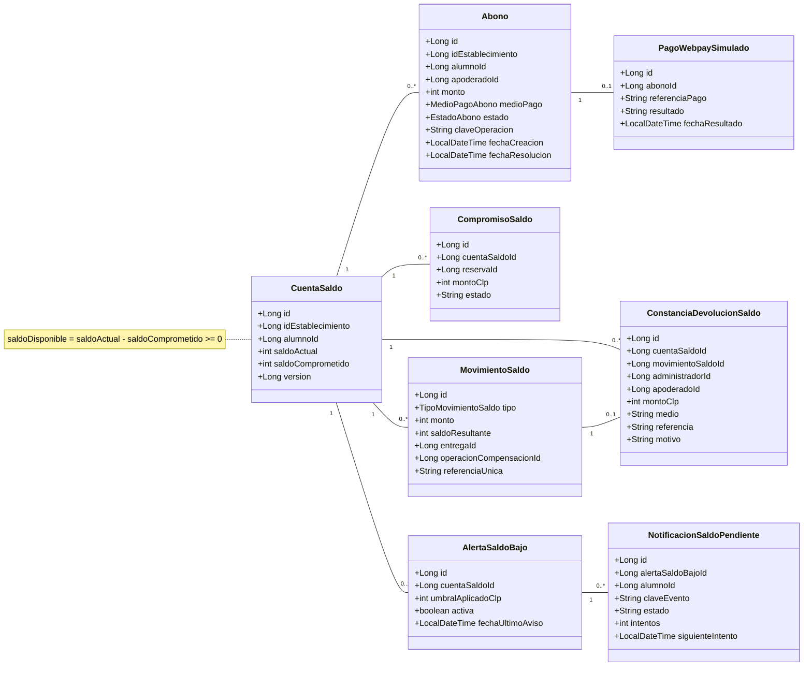

# Modelo de dominio · Saldos y abonos

Vista de las entidades persistidas principales de `db_saldos`. Los identificadores de alumno, apoderado, reserva y entrega pertenecen a otros servicios y no son claves foráneas entre bases.

Los abonos utilizan una pasarela simulada; no se procesa dinero real. La bandeja de alerta de saldo bajo está en revisión y su estado no implica envío de correo real.
