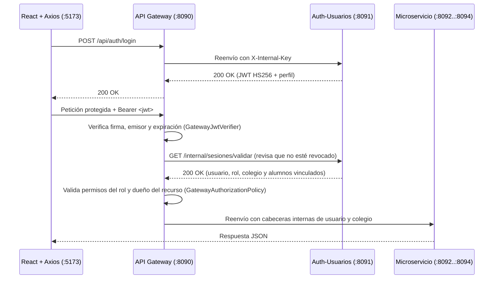

# Seguridad y autenticación JWT en EduSaldo

Este documento resume cómo funciona el inicio de sesión con JWT, el control de permisos por rol y la protección entre el API Gateway y los cuatro microservicios de EduSaldo.

## 1. Cómo entra cada petición al sistema

El frontend en React (`http://localhost:5173`) no se conecta directo a los microservicios: todas las llamadas salen desde la instancia compartida de Axios (`frontend/src/services/api.ts`) hacia el **API Gateway** (`http://localhost:8090`).

Cuando el usuario inicia sesión:
1. El frontend envía `POST /api/auth/login` con identificador y contraseña.
2. `edusaldo-ms-auth-usuarios` (`:8091`) valida las credenciales, guarda la sesión en `db_usuarios` y devuelve un token JWT firmado con `HS256`.
3. El frontend guarda la sesión en `sessionStorage` y Axios envía `Authorization: Bearer <token>` en cada solicitud posterior. Si el servidor responde `401`, la sesión local se limpia y el usuario vuelve al acceso.

## 2. Qué lleva el JWT y cómo se revoca

- **Firma y contenido (`JwtService`):** los tokens se firman con `HS256` (emisor `edusaldo-auth`). Incluyen `sub` (ID del usuario), `jti` (identificador único de la sesión), `tenant` (`idEstablecimiento`), `rol`, `estado`, `rut`, `iat` y `exp`. Nunca se guardan contraseñas ni hashes dentro del token.
- **Validación en el Gateway (`GatewayJwtVerifier` y `GatewaySecurityFilter`):** antes de consultar a `ms-auth-usuarios`, el Gateway rechaza con `401` cualquier petición protegida sin token, con `Bearer` vacío, con firma inválida, `alg: none`, firmada con otra clave o expirada.
- **Cierre de sesión real (`SesionService`):** al emitir el token se guarda `SHA-256(jti)` en la tabla `sesiones_usuario`. Cuando el usuario cierra sesión (`POST /api/auth/cerrar-sesion`), cambia/restablece su contraseña o se bloquea la cuenta por intentos fallidos, la sesión se marca como revocada y reutilizar ese JWT devuelve `401`.
- **Control en el Gateway WebFlux:** en lugar de usar `spring-boot-starter-security` en el Gateway reactivo, los mismos controles (autenticación Bearer, denegación por defecto, permisos por rol/dueño y CORS explícito) se aplican en `GatewaySecurityFilter`, `GatewayJwtVerifier`, `GatewayAuthorizationPolicy` y `GatewayCorsConfiguration`.

## 3. Rutas públicas, bloqueadas y protegidas

- **Públicas (`:8090`):** `GET /salud`, `POST /api/auth/login`, `POST /api/auth/recuperar-password`, `POST /api/auth/confirmar-recuperacion`.
- **Bloqueadas siempre desde fuera (`403`):** cualquier ruta `/internal/**` y las operaciones internas de saldo o bodega (`/api/saldos/{retener,liberar,cobrar,reintegrar}` y `/api/inventario/{retener,liberar,descontar,reingresar}`).
- **Protegidas:** todo el resto de `/api/**`. Si el Gateway o un microservicio rechaza una petición con `403`, el intento queda registrado en la auditoría de `ms-auth-usuarios` sin guardar parámetros de consulta ni datos del cuerpo.
- **Cabeceras de usuario confiables:** el Gateway borra y reemplaza `X-Usuario-Id`, `X-Establecimiento-Id`, `X-Rol` y `X-Internal-Key` con los datos reales de la sesión para evitar que un cliente suplante a otro usuario o colegio.

## 4. Permisos por perfil

| Funcionalidad / Endpoint | `ADMINISTRADOR` | `ENCARGADO` | `APODERADO` | `ALUMNO` ($\ge$ 12 años) |
| :--- | :---: | :---: | :---: | :---: |
| Ver catálogo y categorías (`GET /api/productos`, `/api/categorias`) | Sí | Sí | Sí | Sí |
| Crear, editar o eliminar catálogo (`POST/PUT/DELETE /api/productos`, `/api/categorias`) | Sí | No (`403`) | No (`403`) | No (`403`) |
| Ver cuenta de saldo (`GET /api/saldos/cuenta/{alumnoId}`) | Sí (su colegio) | Sí (su colegio) | Solo hijos vinculados | Solo su cuenta |
| Ver movimientos de saldo (`GET /api/saldos/cuenta/{alumnoId}/movimientos`) | Sí (su colegio) | Sí (su colegio) | Solo hijos vinculados | No (`403`) |
| Abonar saldo Webpay (`POST /api/saldos/abonos/iniciar`, `/confirmar`) | No (`403`) | No (`403`) | Solo hijos vinculados | No (`403`) |
| Reportes financieros, constancias y liquidación (`/api/saldos/reportes/*`, `/constancias`, `/liquidar-retiro`) | Sí (su colegio) | No (`403`) | No (`403`) | No (`403`) |
| Reservar y consultar reservas propias (`/api/reservas` POST, `/alumno/{id}`, `/{id}`, cancelar) | Sí (su colegio) | Sí (su colegio) | Solo hijos vinculados (`PENDIENTE`) | Solo propias (`PENDIENTE`) |
| Listado global de reservas, preparar y entregar (`GET /api/reservas`, `/marcar-lista`, `/entregar`) | Sí | Sí | No (`403`) | No (`403`) |
| Entregas en mesón e historiales globales (`POST /api/entregas/meson`, `GET /api/entregas/historial`, `/dia`, `GET /api/devoluciones`) | Sí | Sí | No (`403`) | No (`403`) |
| Proveedores (`GET /api/proveedores*` y modificaciones) | Lectura y escritura | Solo lectura | No (`403`) | No (`403`) |
| Órdenes de compra (listar, crear, recepcionar / aprobar) | Todo (incl. aprobar) | Listar, crear y recepcionar (`403` aprobar) | No (`403`) | No (`403`) |
| Valorización y costos de ventas (`GET /api/inventario/valorizacion`, `/costos-ventas`) | Sí (su colegio) | No (`403`) | No (`403`) | No (`403`) |
| Usuarios, configuración, auditoría y aprobación de ajustes | Sí (su colegio) | No (`403`) | No (`403`) | No (`403`) |

Las cuentas en estado `PRIMER_ACCESO` solo pueden consultar su sesión, cambiar la contraseña, aceptar el consentimiento y cerrar sesión.

## 5. Acceso directo a los microservicios (`8091–8094`)

Los cuatro microservicios validan cada petición con `InternalAccessFilter`:
- Cualquier llamada directa a `/api/**` o `/internal/**` sin una clave `X-Internal-Key` válida responde `401`.
- En desarrollo local, Swagger (`/swagger-ui.html`, `/api-docs`) queda habilitado en solo lectura (`GET`) con `edusaldo.swagger.public=true` (apagado en el perfil `prod`) y configurado para probar contra `http://localhost:8090` usando `bearerAuth`.

## 6. Cómo comprobarlo

- **Pruebas unitarias JWT (`ms-auth-usuarios`):**
  `cd backend/edusaldo-ms-auth-usuarios && ./mvnw test -Dtest=JwtServiceTest,SeguridadPersistenteTest`
- **Pruebas del Gateway y permisos por rol:**
  `cd backend/edusaldo-api-gateway && ./mvnw test -Dtest=GatewayBoundaryTest`
- **Pruebas HTTP completas contra el entorno local (incluye JWT expirado, revocación, RBAC y acceso directo `8091–8094`):**
  `python3 scripts/4_pruebas_http_automaticas.py`
- **Colección Postman (incluye carpeta `Seguridad JWT y revocación`):**
  [`scripts/pruebas_postman_coleccion.json`](../scripts/pruebas_postman_coleccion.json)
